<div align="center">

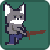

# ⚔️ Beat And Match To Pass

**Beat them all… or not. Beat the *right* enemies to open the way!**

A fast pixel-art beat 'em up where every swing counts, **solo or with a friend on the same screen**.
Free · 1–2 players · Linux · Web · Made with Godot 4

[](https://flathub.org/apps/org.dupot.beatmatchtopass)
[](https://snapcraft.io/dupot-beat-match-to-pass)
[](https://godotengine.org)
[](LICENSE)

<a href="https://flathub.org/apps/org.dupot.beatmatchtopass"></a>
<a href="https://snapcraft.io/dupot-beat-match-to-pass"></a>

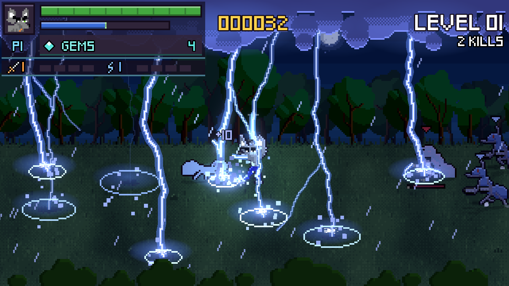

</div>

---

## 📖 The idea

Gordon's path through the forest is blocked by **electric barriers**. Each barrier shows an enemy: an ant, a beetle or a spider. Only defeating **that kind of enemy** charges it, and once it is full, it shuts down and the way is open.

So you don't just mash buttons: you pick your targets, keep your combo going and save your lightning for the right moment. Clear every barrier, reach the gate, and move on to the next level.

<div align="center">

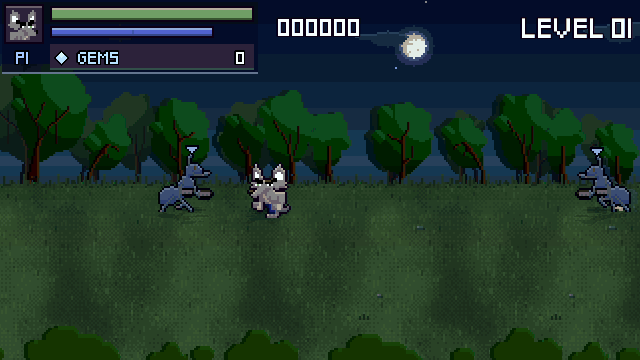

</div>

## 👥 Play together on one screen

Grab a friend: pick **2 PLAYERS** in the menu and fight side by side through the whole adventure, bonus stages included.

<div align="center">

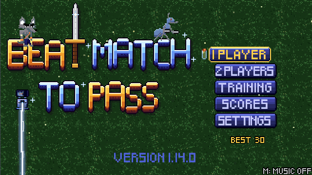

</div>

- 🎮 **Any setup**: two players on **one keyboard**, a **keyboard + a gamepad**, or **two gamepads**.
- ⌨️ **Your keys, your way**: AZERTY and QWERTY presets out of the box, and every key (and every gamepad action button) can be remapped before the game starts. The setup is remembered for next time.
- 🎥 **One shared camera** keeps both heroes in view: nobody gets left off-screen.
- 🐜 **Smart enemies** go after the closest hero, so you can split the crowd or bait them for your partner.
- 🤝 **Team play**: score and kill streak are shared, each hero has their own life and mana bars (a lightning storm each), and any life bottle heals whoever grabs it.
- 🔥 **Made for two**: more barriers to open and enemies arriving faster than in solo.
- 💫 **Never out for long**: a fallen partner gets back up at the next level with half their life. It's game over only when both heroes are down.
- 🐺 **Two heroes**: player 2 is Gordon's blue-grey twin, with *P1* / *P2* tags above their heads.

## ✨ Features

- 👥 **Solo or two players on the same screen**: see [Play together on one screen](#-play-together-on-one-screen).
- 🗡️ **Quick and heavy attacks**: quick slashes deal 8 damage in 0.26 seconds; heavy overhead swings deal 24 in 0.70 seconds. Mix them into nine chains that trigger automatic flurries, crossed slashes or a ground slam with area damage.
- 💨 **Dash**: a quick dodge in any direction that makes you untouchable for an instant, and cancels a sword swing.
- 🔥 **Kill streaks**: every 5 kills in a row raise your score multiplier, up to **x4**. Get hit and the streak is gone.
- ⚡ **Lightning storm**: spend your mana to darken the sky and call down three volleys of lightning on everything around you. You can't be hurt while casting, so it also works as a panic button.
- 🐜 **Three enemy types**: ants swarm you, beetles hit hard, and spiders shoot from a distance. Beetles join in at level 2 and spiders at level 3, and every level adds more barriers to open.
- 🧪 **Life bottles**: they show up from level 2 on to heal you mid-fight.
- 🐿️ **Bonus stage**: between levels you get 15 seconds to hit the squirrels and grab extra life bottles.
- 🏆 **Best scores**: chase your record, with a big *NEW RECORD!* when you beat it.
- 🎵 **Chiptune music and retro sound effects**, plus hit-stop, screen shake and particles that make every blow land.
- ⏸️ **Pause anytime**, keys you can remap, gamepad support and on-screen touch controls for touch screens.

## 🎬 From boot to battle

A loading screen that really preloads the game, an animated title, a lively menu and smooth fades between every screen.

<div align="center">


</div>

## 📸 Screenshots

<div align="center">

| | | |
|:---:|:---:|:---:|
| 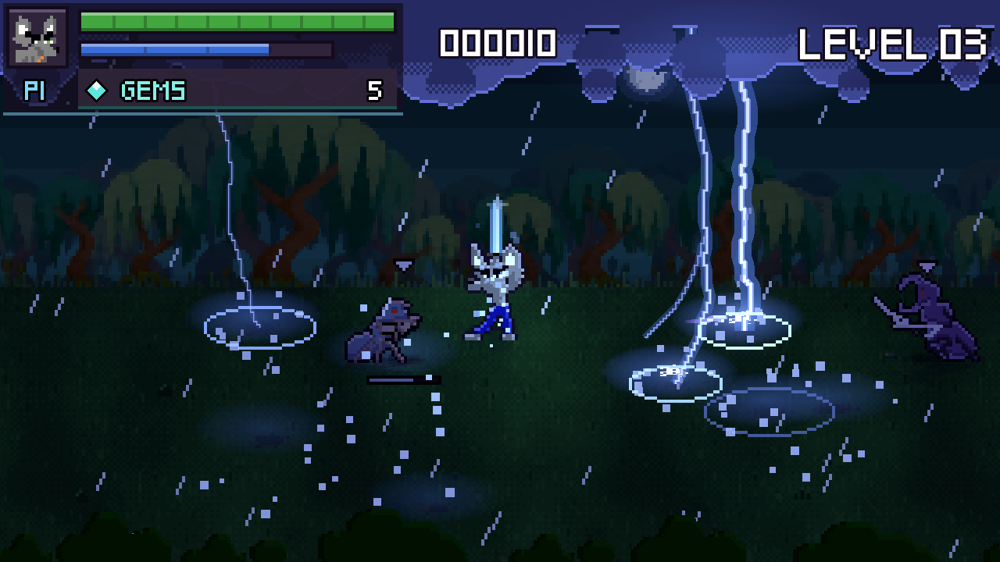 | 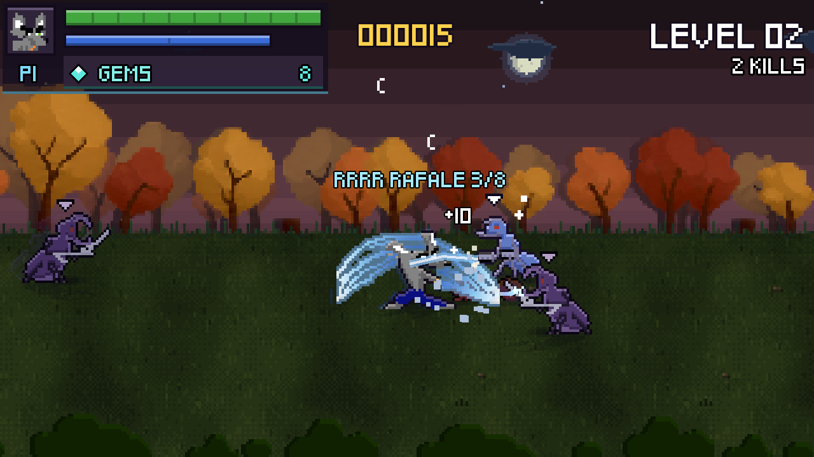 | 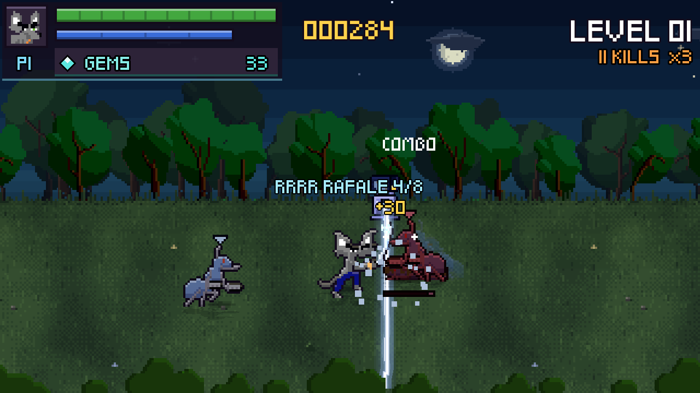 |
| 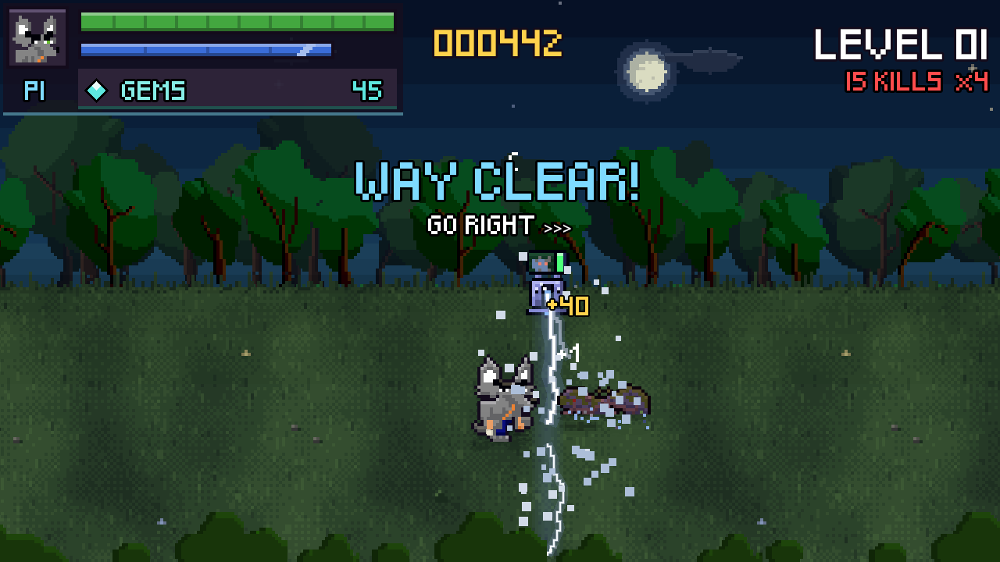 | 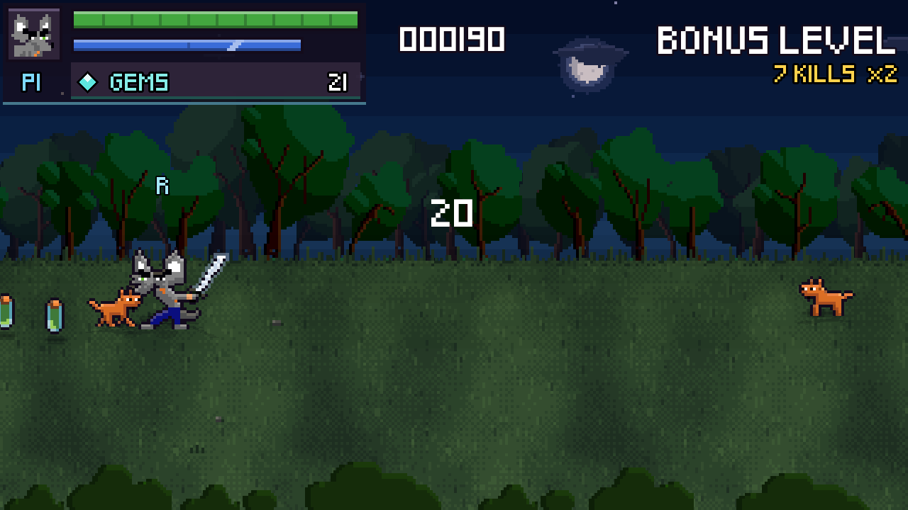 | 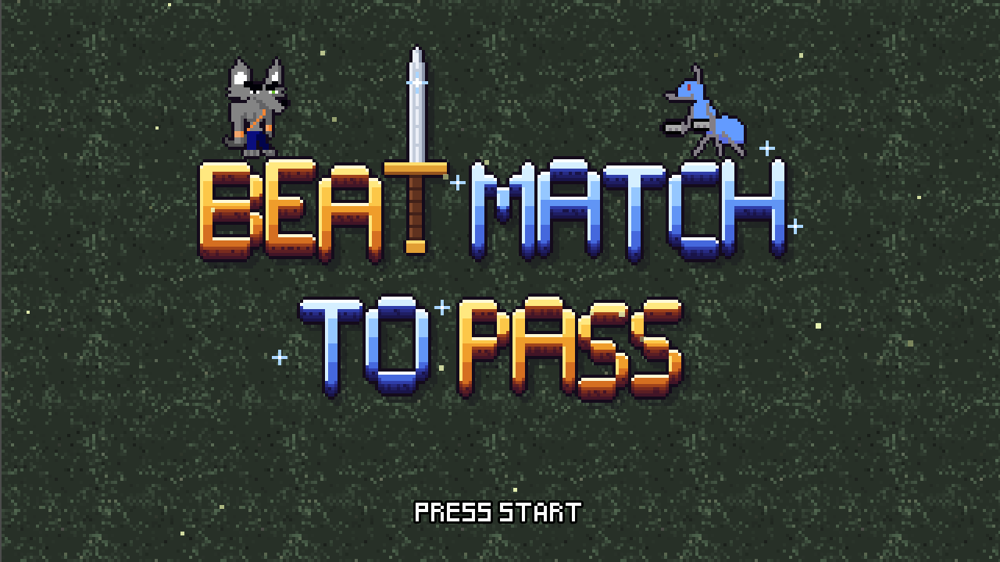 |
| 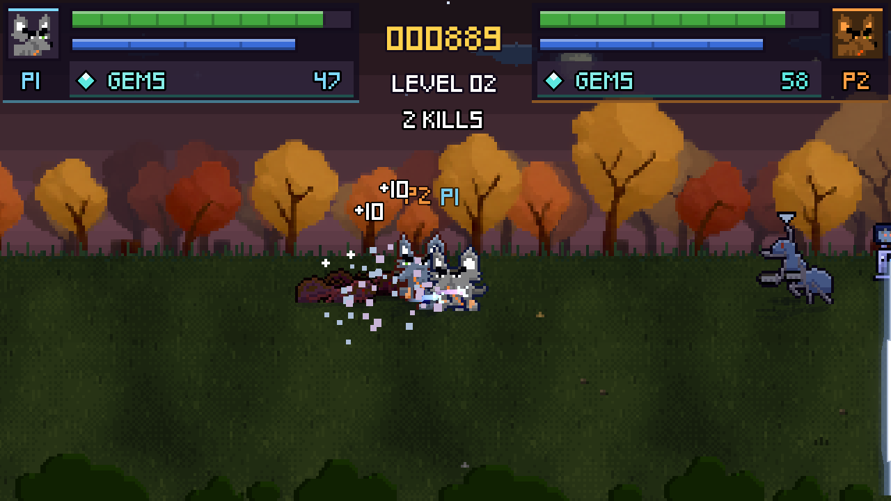 | 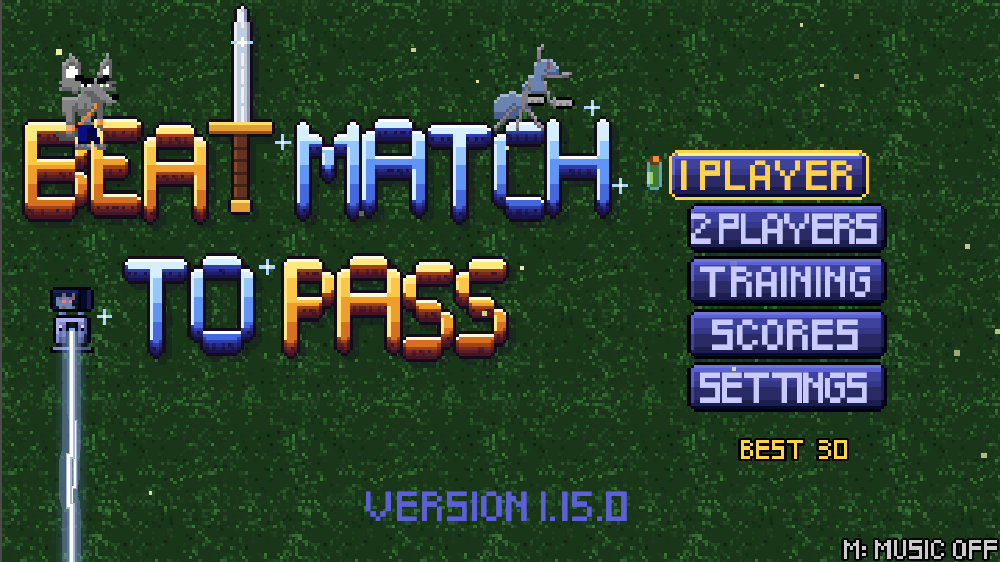 | 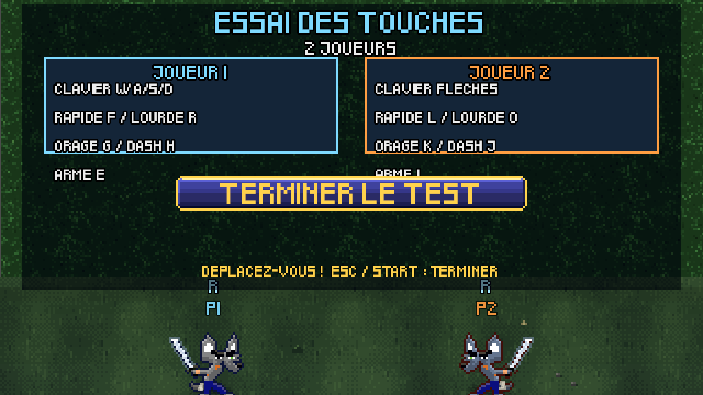 |

</div>

## 🎮 Controls

| Action | Keyboard | Gamepad |
|---|---|---|
| Move | ← ↑ → ↓ arrow keys | D-pad / stick |
| Quick attack | `Enter` or `Space` | Button A |
| Heavy attack | `X` | Button Y |
| Lightning storm (needs mana) | `Ctrl` | Button B |
| Dash (short dodge, invincible) | `Shift` | Button X |
| Pause | `Esc` | Start |
| Music on / off | `M` | — |

⌨️ Keys can be remapped from the **Settings** menu, and on-screen touch controls can be turned on for touch screens.

**Two players** — default keys when you share one keyboard (changeable in the 2 PLAYERS screen):

| Action | Player 1 (QWERTY / AZERTY) | Player 2 | Gamepad |
|---|---|---|---|
| Move | `W A S D` / `Z Q S D` | ← ↑ → ↓ arrow keys | D-pad / left stick |
| Quick attack | `F` | `L` | Button A |
| Heavy attack | `R` | `O` | Button Y |
| Lightning storm | `G` | `K` | Button B |
| Dash | `H` | `J` | Button X |
| Pause | `Esc` | `Esc` | Start |

Quick (`R`) and heavy (`L`) inputs appear above your character. Press the next button during the last 0.24 seconds of the current swing. One press buffers one next attack; holding a button does not repeat. Damage, dash, storm and the end of a chain clear the combo.

| Chain | Finisher | Automatic attack |
|---|---|---|
| R R R R | Rafale | 8 hits × 8 damage |
| R R R L | Exécution | Ground slam, 64 area damage |
| R R L | Brise-garde | Ground slam, 48 area damage |
| R L R | Contre-taille | 6 hits, alternating 8 / 12 damage |
| R L L | Fendoir | Ground slam, 48 area damage |
| L R R | Riposte | 6 hits, alternating 8 / 12 damage |
| L R L | Croisé | 6 hits, alternating 10 / 14 damage |
| L L R | Revers | 6 hits, alternating 8 / 12 damage |
| L L L | Fracas | Ground slam, 48 area damage |

All sword attacks use the accepted cross sprite sheet in each player’s `combo/` directory. Rest, walk, hurt, potion, magic and defeat sprites share the same character design, palette and ground anchor. The flurry chains eight sword cuts in 32 poses over 2.30 seconds: downward cut, left-to-right sweep, right-to-left return, rising cut, downward cut, rising return, downward cut and final thrust. The alternating combo chains six cuts in 24 poses over 2.80 seconds, alternating quick cuts and heavier follow-throughs: rise, descent, sweep, return, rise and final descent. Shared cross poses and the new follow-up sheet keep one character design. Early impacts use short knockback to keep enemies within reach; the final hit pushes them away. Player 2 keeps the blue-grey palette variant. Finishers play their full animation automatically after the last input. Buffer another attack during their last 0.24 seconds to flow directly into the next chain. The ground slam raises the sword, strikes the floor and produces cracks, debris and a shockwave. It damages nearby enemies on the same depth lane once; the longer R R R L chain has the strongest impact.

Heavy attacks have a visible wind-up, the original blue sword trail and stronger knockback. Each swing damages a given enemy once. Dash can cancel either attack type.

## Training

Choose **TRAINING** in the main menu, then one or two players. The practice enemy stays in place and never attacks. Its health bar decreases with each hit; after death it respawns at the same spot with full health, so you can practise continuously.

Use **COMBOS** in the arena (keyboard `C` / gamepad `LB`) to show or hide the available quick/heavy chains and practise their timing. Use **MENU** (`Esc` / Start) to leave training.

## 💡 Tips

- **Look at the barrier icon** before you fight: defeating the wrong species won't charge the barrier. Enemies that still charge a barrier carry a small arrow of its colour above their head.
- **Protect your streak.** Backing off for a second is often worth more than trading hits.
- **Mana refills on its own** and with every kill. The bar turns blue and *MANA READY* pops up when you can cast again.
- **Playing as two?** Split up to take enemies from both sides, and agree on who casts the storm: the mana bar is shared.
- **Keep the storm for crowds**, or for when a spider has you in its sights: you're untouchable while casting.

## 📦 Install

### Flathub (Linux, recommended)

```bash
flatpak install flathub org.dupot.beatmatchtopass
flatpak run org.dupot.beatmatchtopass
```

You can also install it from GNOME Software, KDE Discover or any app store that uses Flathub. The Flatpak manifest lives in [flathub/org.dupot.beatmatchtopass](https://github.com/flathub/org.dupot.beatmatchtopass).

### Snap Store (Linux)

```bash
sudo snap install dupot-beat-match-to-pass
```

## 🛠️ Build from source

1. Install [Godot 4.7](https://godotengine.org/download).
2. Clone the repository:
   ```bash
   git clone https://github.com/imikado/dupotBeatAndMatchToPass.git
   ```
3. Open `project.godot` in Godot and press **F5** to play.

Export presets for **Linux** and **Web (HTML5)** are included in `export_presets.cfg`. Snap packaging files live in [`export/linux/snap`](export/linux/snap).

All the sound effects and the music are generated by a small dependency-free Python script. Tweak it and run it again to change them:

```bash
python3 tools/generate_audio.py
```

## 🕹️ More from dupot.org

Also on Flathub from the same developer:

- **Save the Sheep**
- **Little Adventure**
- **Easyflatpak**

See them all on [dupot.org](https://www.dupot.org/games.html).

## 🐛 Feedback

Found a bug or have an idea? [Open an issue](https://github.com/imikado/dupotBeatAndMatchToPass/issues).

## 📜 License

This game is released under the [GNU LGPL v2.1](LICENSE).

---

<div align="center">

Made with ❤️ and [Godot Engine](https://godotengine.org) by [Michael Bertocchi](https://www.dupot.org/games.html) · [dupot.org](https://www.dupot.org)

</div>

Combat regression tests: `godot --headless --path . res://tests/combat_test.tscn`.
Training regression tests: `godot --headless --path . res://tests/training_test.tscn`.

Finisher regression tests: `godot --headless --path . res://tests/finisher_test.tscn`.


Rebuild the generated combo sheets: `python3 -B chatgpt/generated/prepare_sprites.py`. The filled prompts, original generations and conversion settings are kept under `chatgpt/`.

Appearance regression tests: `godot --headless --path . res://tests/appearance_test.tscn`.
